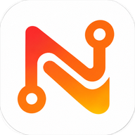
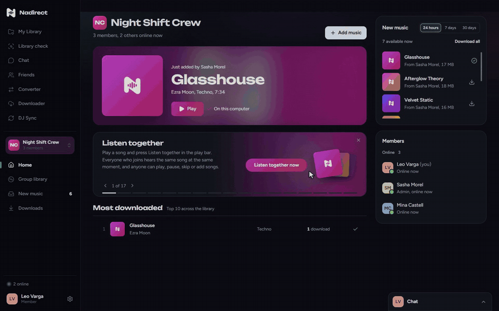
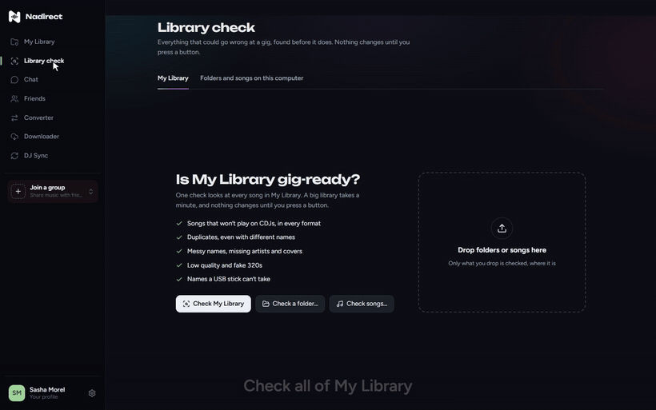
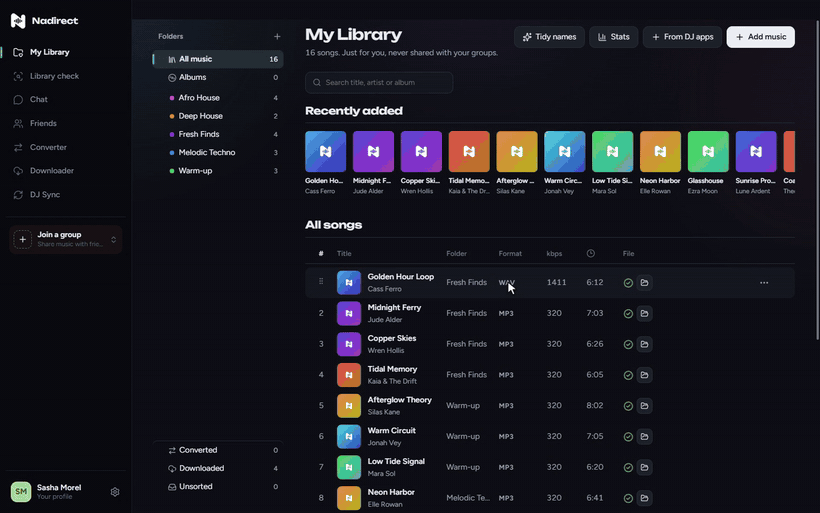
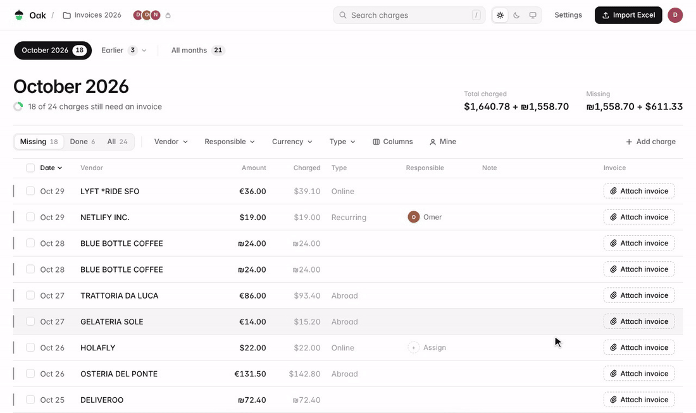
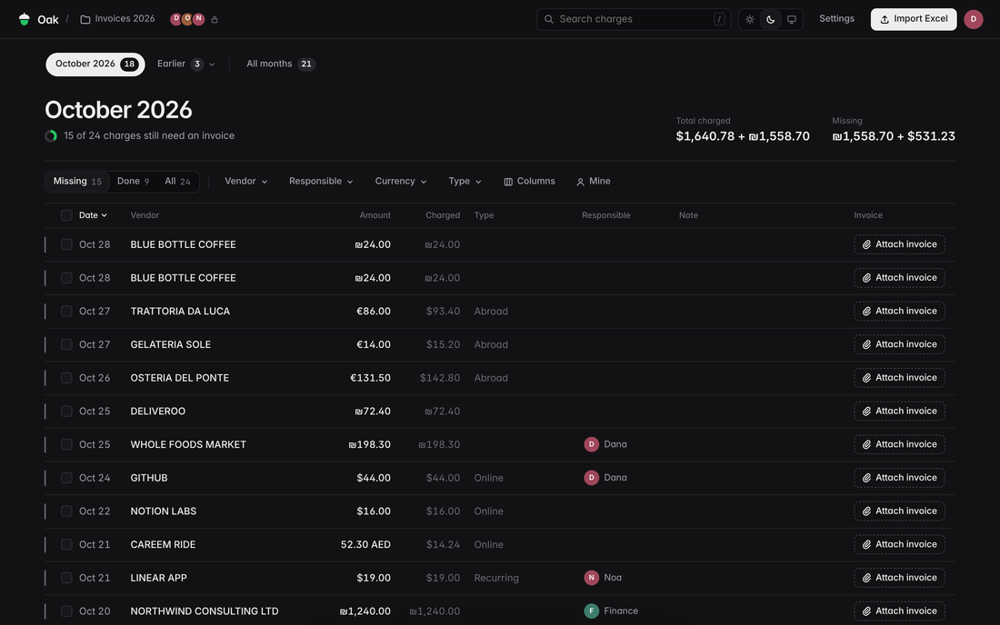
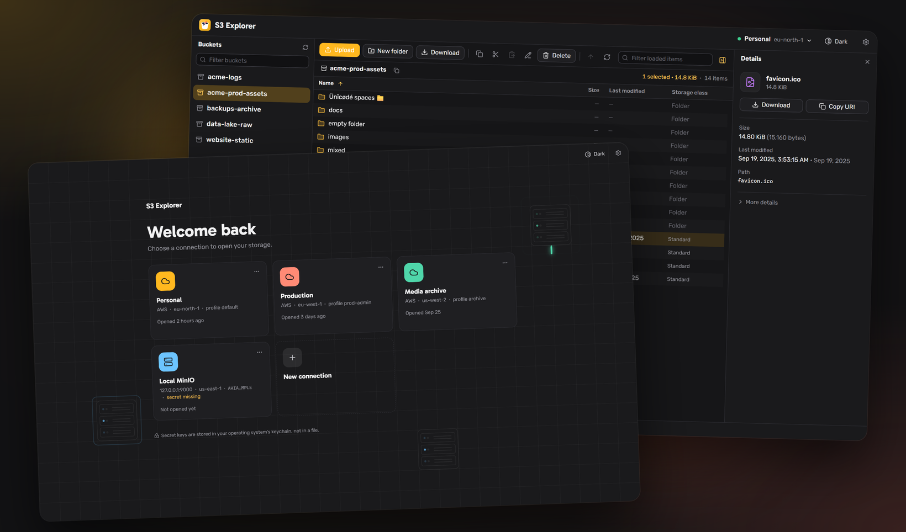
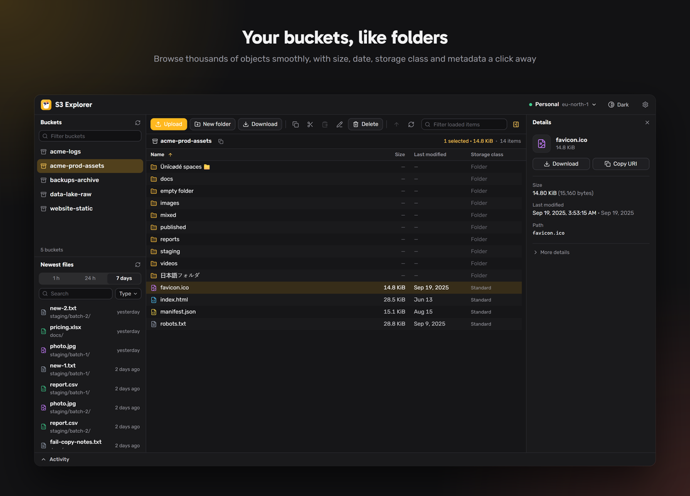
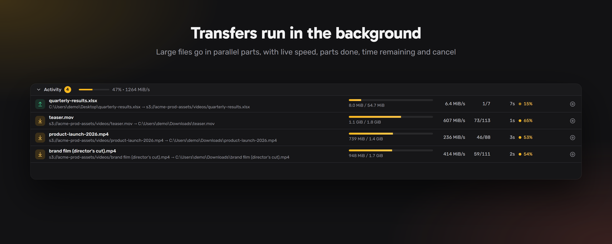

<h1 align="center">Itay Nadir</h1>

Just a person with ideas, and the passion to build them.

 

  &nbsp;&nbsp;&nbsp;&nbsp;
  &nbsp;&nbsp;&nbsp;&nbsp;
  &nbsp;&nbsp;&nbsp;&nbsp;
  

 

<h2> Nab</h2>

**Your GitLab, at the speed of your keyboard.** Issues, merge requests and pipelines in one fast desktop app, with an AI assistant that runs on your own computer. Windows, macOS and Linux.

[Releases](https://github.com/itay5731/Nab-releases/releases)

<table>
  <tr>
    <td colspan="2"> <b>Your day on one page.</b> What's late, what's waiting on you, and every review a click away.</td>
  </tr>
  <tr>
    <td width="50%"> <b>Say it, it's done.</b> "Assign mobile#62 to me" and Nab does it.</td>
    <td width="50%"> <b>Ask anything.</b> It reads your issues and answers, with its sources.</td>
  </tr>
</table>

<h2> Nadirect</h2>

**The music app for DJs and their crews.** Find the tracks that won't play at the club before the club does, send your library to Rekordbox and Serato, and share music with your crew straight from computer to computer, never through a server. Mac and Windows, free.

[Download at nadirect.co](https://nadirect.co) · [How-to videos](https://nadirect.co/videos) · [Releases](https://github.com/itay5731/Nadirect-releases/releases)

<table>
  <tr>
    <td colspan="2"> <b>Your crew's music, one library.</b> See what your friends just added and take what you want.</td>
  </tr>
  <tr>
    <td width="50%"> <b>Library check.</b> Every song that won't play on CDJs, fixed in one click.</td>
    <td width="50%"> <b>DJ Sync.</b> Your folders become playlists in Rekordbox and Serato.</td>
  </tr>
</table>

<h2> Oak</h2>

**Which company card charges still need an invoice.** Import the monthly Excel, drop invoices in, and they're saved to your Google Drive. Free, runs on Google Apps Script.

[Repository](https://github.com/itay5731/Oak)

<table>
  <tr>
    <td colspan="2"> <b>Match.</b> Drop a pile of invoices; each finds its charge.</td>
  </tr>
  <tr>
    <td width="50%"> <b>Attach.</b> Drop an invoice on a charge and it's done.</td>
    <td width="50%"> <b>The month at a glance.</b> What's done and what's still missing.</td>
  </tr>
</table>

<h2> S3Explorer</h2>

**A fast desktop app for Amazon S3.** I'm a contributor to [yonatand/S3Explorer](https://github.com/yonatand/S3Explorer): I redesigned the whole interface and built tabs in each pane, pausing and resuming transfers, previewing files without downloading them, bookmarks, speed limits, a transfer history that survives restarts, folder sizes, editing an object's metadata, and what's new after an update.

[My commits](https://github.com/yonatand/S3Explorer/commits?author=itay5731)

<table>
  <tr>
    <td colspan="2"></td>
  </tr>
  <tr>
    <td width="50%"> <b>Browse.</b> A bucket open, with a file's details beside it.</td>
    <td width="50%"> <b>Transfers.</b> Big files in parallel parts; pause and resume any time.</td>
  </tr>
</table>

 

Built with TypeScript, React, Electron, Rust and Tauri, peer-to-peer networking, and AI that runs on your own computer.
