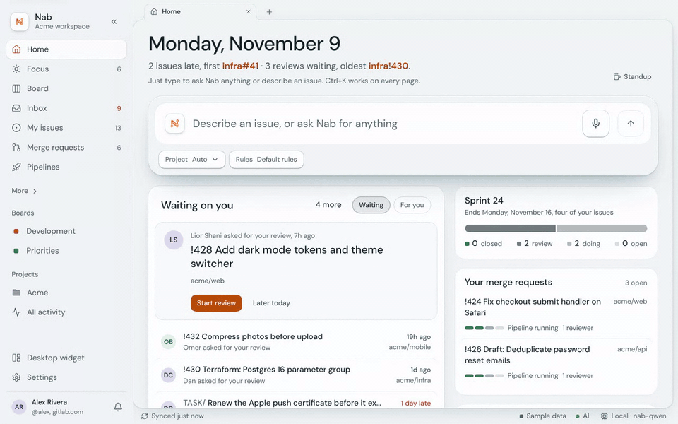
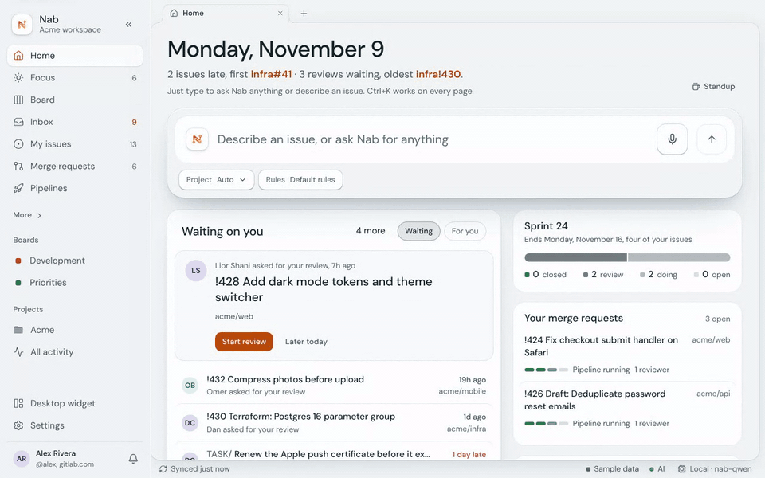
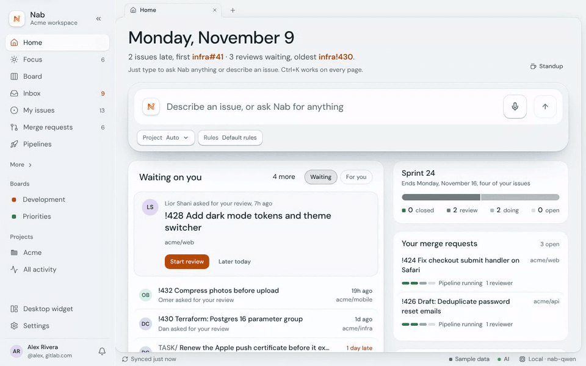
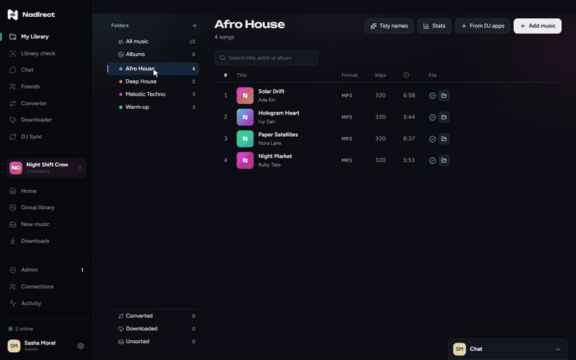
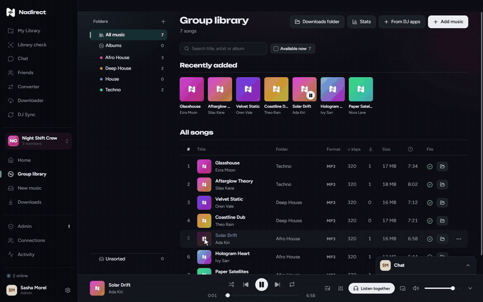

<picture>
  <source media="(prefers-color-scheme: dark)" srcset="assets/banner-dark.svg">
  
</picture>

I design and build my apps end to end, from the first sketch to the installer and the website. Each one does a single job, and does it well.

<h2> Nab</h2>

**Your GitLab, at the speed of your keyboard.** Issues, merge requests and pipelines in one fast desktop app, with an AI assistant that runs on your own computer. Windows, macOS and Linux.

[Releases](https://github.com/itay5731/Nab-releases/releases)

<table>
  <tr>
    <td colspan="2"> <b>Your day on one page.</b> What's late, what's waiting on you, and every review a click away.</td>
  </tr>
  <tr>
    <td width="50%"> <b>Say it, it's done.</b> "Assign mobile#62 to me" and Nab does it.</td>
    <td width="50%"> <b>Ask anything.</b> It reads your issues and answers, with its sources.</td>
  </tr>
</table>

<h2><picture><source media="(prefers-color-scheme: dark)" srcset="assets/icon-nadirect-white.svg"></picture> Nadirect</h2>

**The music app for DJs and their crews.** Find the tracks that won't play at the club before the club does, send your library to Rekordbox and Serato, and share music with your crew straight from computer to computer, never through a server. Mac and Windows, free.

[Download at nadirect.co](https://nadirect.co) · [How-to videos](https://nadirect.co/videos) · [Releases](https://github.com/itay5731/Nadirect-releases/releases)

<table>
  <tr>
    <td width="50%"> <b>Library check.</b> Every song that won't play on CDJs, fixed in one click.</td>
    <td width="50%"> <b>Share with your crew.</b> Pick the songs, pick the group's folder, done.</td>
  </tr>
  <tr>
    <td width="50%"> <b>Listen together.</b> Same song, same moment, one shared queue.</td>
    <td width="50%"> <b>DJ Sync.</b> Your folders become playlists in Rekordbox and Serato.</td>
  </tr>
</table>

<h2> Oak</h2>

**Which company card charges still need an invoice.** Import the monthly Excel, drop invoices in, and they're saved to your Google Drive. Free, runs on Google Apps Script.

[Repository](https://github.com/itay5731/Oak)

<table>
  <tr>
    <td width="50%"> <b>Attach.</b> Drop an invoice on a charge and it's done.</td>
    <td width="50%"> <b>Match.</b> Drop a pile of invoices; each finds its charge.</td>
  </tr>
</table>

<h2> S3Explorer</h2>

**A desktop browser for Amazon S3.** I redesigned its interface and built its Windows installer, in my fork of [yonatand/S3Explorer](https://github.com/yonatand/S3Explorer).

[My fork](https://github.com/itay5731/S3Explorer)

 

Built with TypeScript, React, Electron, Rust and Tauri, peer-to-peer networking, and AI that runs on your own computer.
